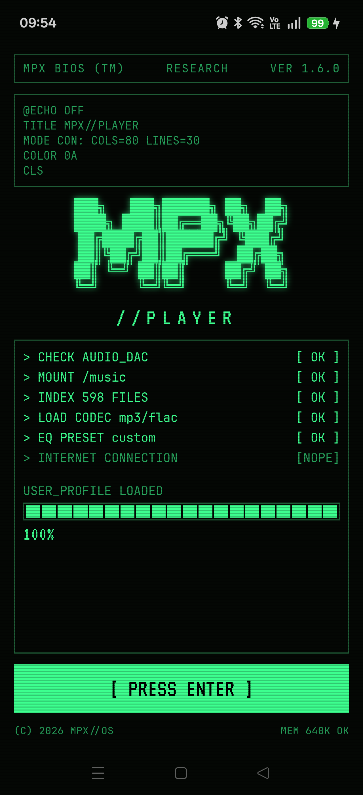
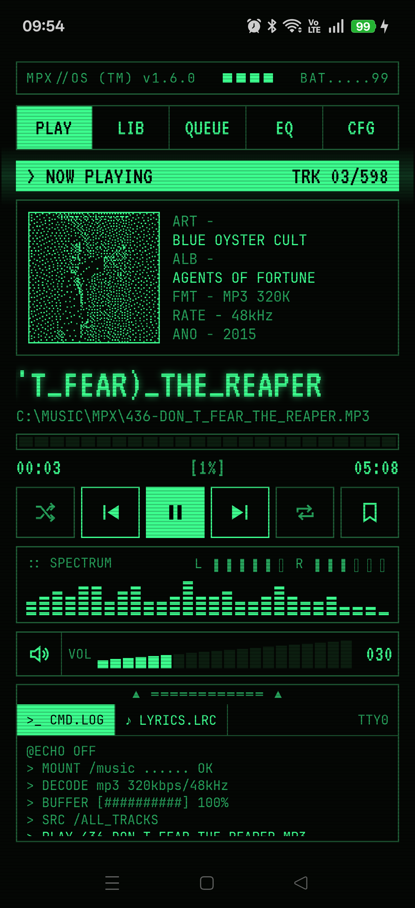
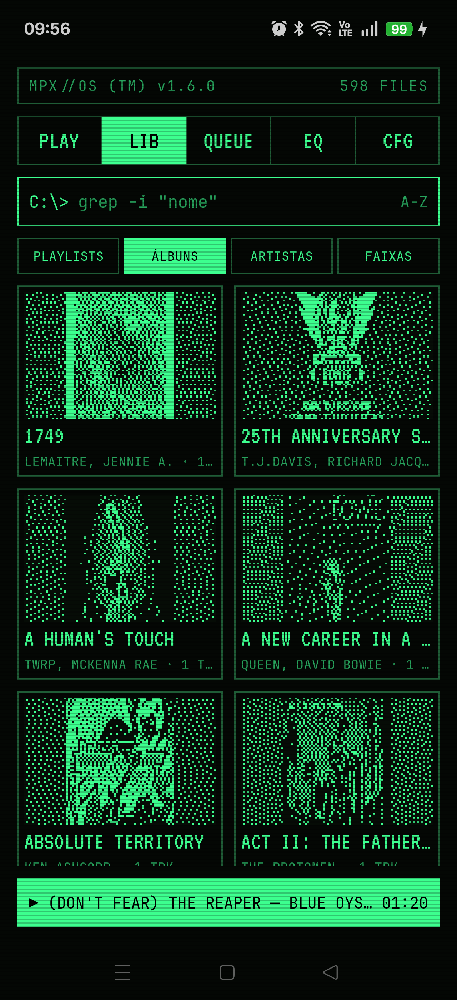
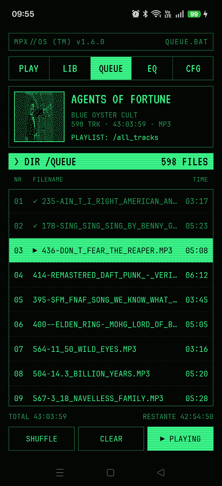
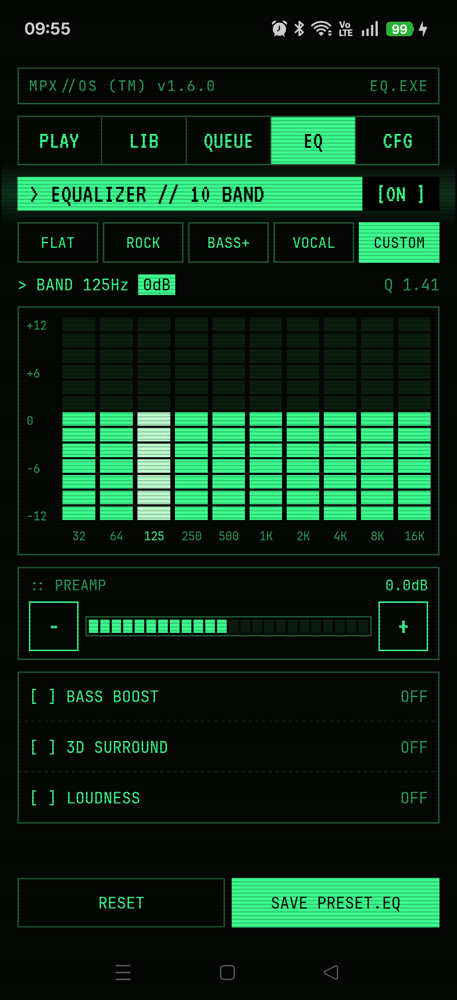
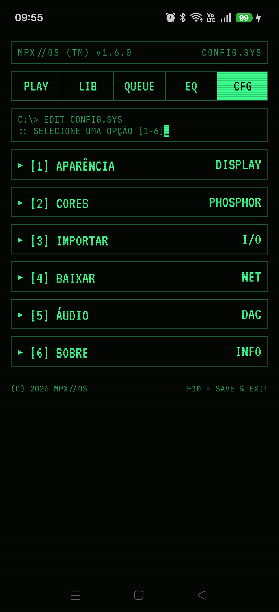
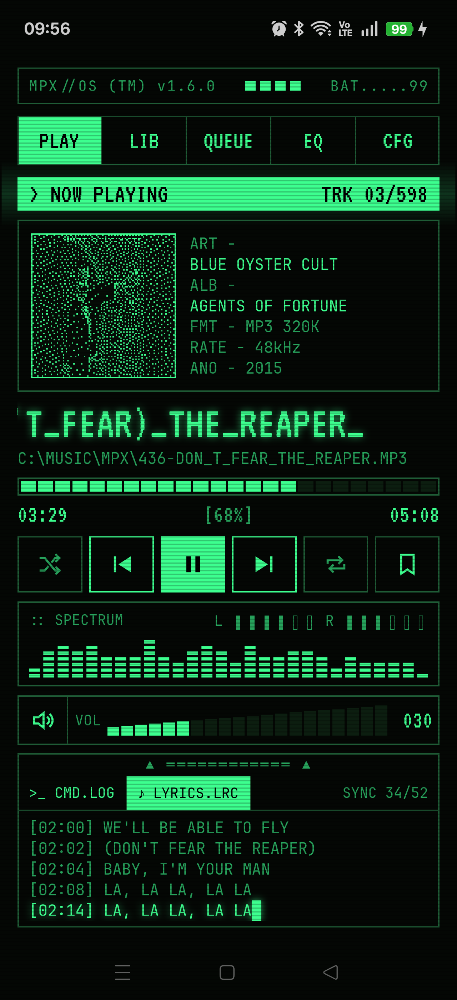
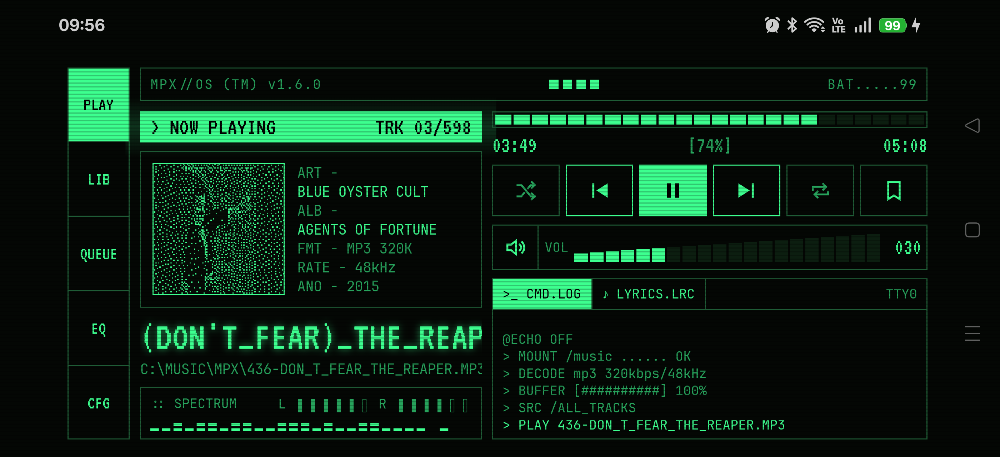

```
███╗   ███╗██████╗ ██╗  ██╗
████╗ ████║██╔══██╗╚██╗██╔╝
██╔████╔██║██████╔╝ ╚███╔╝
██║╚██╔╝██║██╔═══╝  ██╔██╗
██║ ╚═╝ ██║██║     ██╔╝ ██╗
╚═╝     ╚═╝╚═╝     ╚═╝  ╚═╝
             //PLAYER
```
**zero anúncios, zero assinaturas, apenas músicas**

# MPX//PLAYER

> Um player de MP3 para Android com estética **CRT / DOS** — fósforo verde, scanlines, capas em
> dither 1-bit e uma interface que parece um BIOS dos anos 80. Offline no essencial, mas com
> downloader de playlists, letras sincronizadas e auto-update, do jeito que um MP3 player deve ser.

<p align="center">
  
  
  
</p>

Pacote: `com.mpx.player` · minSdk 29 (Android 10) · arm64-v8a · 100% Kotlin + Jetpack Compose.

---

## Recursos

- 🎵 **Biblioteca local** via MediaStore — álbuns, artistas e faixas, com busca e ordenação A‑Z / Z‑A.
- ▶️ **Player** sobre Media3/ExoPlayer: fila, shuffle, repeat, **controle pela notificação**
  (MediaSession) e serviço de reprodução em primeiro plano.
- 🎛️ **Equalizador de 10 bandas** com presets (FLAT / ROCK / BASS+ / VOCAL / CUSTOM), preamp e
  **Bass Boost · 3D Surround · Loudness** (via `android.media.audiofx`).
- 🖥️ **Estética CRT/DOS**: temas de fósforo, **cor personalizada** (sliders R/G/B), scanlines, glow e
  **capas filtradas** no estilo do app (dither 1‑bit / ASCII / mono).
- 🎤 **Letras sincronizadas (.lrc)** no Now Playing (modo karaokê) + **"Buscar letras faltantes"**:
  baixa a letra das músicas que estão sem, **sem rebaixar o áudio**.
- ⬇️ **Downloader de playlists do YouTube Music → MP3** (yt‑dlp), com **capa** e **letra** embutidas.
- 📂 **Playlists** (criar / editar / favoritar), **edição de faixa** (título / capa / letra, só dentro
  do app) e **importação de `.m3u` / `.pls`**.
- 🔁 **Modo paisagem** dedicado em todas as telas (navegação vira barra lateral).
- 🚀 **Auto‑update in‑app** (CFG → SOBRE → CHECK UPDATE) pelas GitHub Releases.

---

## Telas

| Boot | Now Playing | Biblioteca (álbuns) |
|---|---|---|
|  |  |  |

| Fila | Equalizador | Config (CONFIG.SYS) |
|---|---|---|
|  |  |  |

| Letras sincronizadas |
|---|
|  |

**Modo paisagem**

<p align="center">
  
</p>

> Screenshots tirados direto de um aparelho Android rodando a versão atual.

---

## Tecnologias

| Área | Stack |
|------|-------|
| Linguagem | **Kotlin** 2.0.21 (JVM 17) |
| UI | **Jetpack Compose** (BOM 2024.12.01) — sem Material; componentes próprios (CRT) |
| Reprodução | **Media3 / ExoPlayer** 1.5.1 (`media3-exoplayer` + `media3-session`) |
| Efeitos de áudio | `android.media.audiofx` — Equalizer, BassBoost, Virtualizer, LoudnessEnhancer |
| Assíncrono | **kotlinx-coroutines** 1.9.0 (+ `coroutines-guava` p/ `ListenableFuture`) |
| Preferências | **DataStore** (Preferences) 1.1.1 |
| Arquivos (SAF) | **DocumentFile** 1.0.1 |
| Download | **youtubedl-android** 0.18.1 (`library` + `ffmpeg`) — yt-dlp/Python/FFmpeg nativos |
| JSON | `org.json` (nativo do Android) |
| Build | **AGP** 8.7.3 · Gradle (Kotlin DSL) · `compileSdk`/`targetSdk` 35 · `minSdk` 29 · ABI `arm64-v8a` |
| CI | **GitHub Actions** — compila o APK assinado e publica a release |

Injeção de dependências é **manual** (um `AppContainer` por processo em `MpxApp.kt`), sem framework.

---

## APIs e integrações

| Serviço | Uso no app | Onde |
|---------|------------|------|
| **LRCLIB** (`lrclib.net`) | Letra sincronizada (fonte principal) | `data/LyricsRepository.kt` |
| **NetEase Cloud Music** (`music.163.com`) | Letra sincronizada (fallback do LRCLIB) | `data/LyricsRepository.kt` |
| **GitHub Releases API** (`api.github.com`) | Checar/baixar a atualização do app | `data/UpdateRepository.kt` |
| **YouTube / YouTube Music** (via yt-dlp) | Download de playlists/álbuns/músicas → MP3 | `data/Downloader.kt` |
| **Android MediaStore** | Indexar a biblioteca e publicar o que foi baixado | `data/LibraryRepository.kt` |
| `MediaMetadataRetriever` | Ler tags (título/artista/álbum/duração/capa) | `data/Downloader.kt`, `CoverArtLoader.kt` |
| `FileProvider` | Entregar o APK baixado ao instalador do sistema | `UpdateRepository.kt` + `res/xml/file_paths.xml` |

A busca de letras é uma **cadeia de provedores** extensível (`LRCLIB → NetEase`): basta implementar
`(título, artista, álbum, duração) → .lrc?` e incluir na lista para adicionar outra fonte.

### Permissões

`INTERNET` · `READ_MEDIA_AUDIO` (API 33+) · `READ_EXTERNAL_STORAGE` (≤ API 32) ·
`REQUEST_INSTALL_PACKAGES` · `FOREGROUND_SERVICE` · `FOREGROUND_SERVICE_MEDIA_PLAYBACK` ·
`MODIFY_AUDIO_SETTINGS` · `WAKE_LOCK`.

---

## Estrutura do projeto

```
mpx-player/
├─ app/
│  ├─ build.gradle.kts              # módulo, assinatura de release, dependências
│  ├─ proguard-rules.pro
│  └─ src/main/
│     ├─ AndroidManifest.xml
│     ├─ java/com/mpx/player/
│     │  ├─ MainActivity.kt         # Activity única (host do Compose)
│     │  ├─ MpxApp.kt               # Application + AppContainer (DI manual)
│     │  ├─ data/                   # repositórios e fontes de dados
│     │  │  ├─ LibraryRepository.kt     # scan do MediaStore + merge de overrides
│     │  │  ├─ LyricsRepository.kt      # letras .lrc: LRCLIB + NetEase, "buscar faltantes"
│     │  │  ├─ Downloader.kt            # YouTube Music → MP3 (yt-dlp), capa + letra
│     │  │  ├─ UpdateRepository.kt      # auto-update via GitHub Releases
│     │  │  ├─ SettingsRepository.kt    # DataStore (tema, cor, EQ, pastas...)
│     │  │  ├─ PlaylistRepository.kt    # playlists em JSON (Favoritos travado)
│     │  │  ├─ OverrideRepository.kt    # edição de faixa (título/capa) só no app
│     │  │  ├─ PlaylistImporter.kt      # importa .m3u / .pls
│     │  │  ├─ CoverArtLoader.kt        # capas + filtro dither/ASCII/mono
│     │  │  └─ ImageStore.kt            # copia/reduz imagens escolhidas (EXIF)
│     │  ├─ model/
│     │  │  └─ Models.kt                # Track, Album, Artist, Playlist, Eq...
│     │  ├─ playback/
│     │  │  ├─ PlaybackService.kt       # Media3 MediaSessionService (foreground)
│     │  │  ├─ PlayerController.kt       # controle do ExoPlayer / fila
│     │  │  └─ AudioEffects.kt          # Equalizer/BassBoost/Virtualizer/Loudness
│     │  └─ ui/
│     │     ├─ ViewModels.kt            # Player / Library / Settings / Eq
│     │     ├─ screens/                 # Boot, NowPlaying, Library(+Dialogs), Queue, Eq, Settings
│     │     ├─ components/              # Crt, Cover, Icons (widgets retrô)
│     │     └─ theme/                   # MpxTheme (fósforos, fontes VT323 / JetBrains Mono)
│     └─ res/                       # ícones, fontes, file_paths.xml
├─ .github/workflows/release.yml    # CI: compila APK assinado + publica release
├─ docs/screenshots/                # imagens deste README
├─ CHANGELOG.md                     # histórico (Keep a Changelog)
├─ RELEASING.md                     # processo de release / versionamento
└─ README.md
```

---

## Arquitetura (resumo)

- **UI declarativa** em Compose, uma única `MainActivity`; navegação por abas (PLAY / LIB / QUEUE /
  EQ / CFG) controlada por estado. Em paisagem a navegação vira **barra lateral**.
- **ViewModels** expõem `StateFlow`s; os repositórios concentram o acesso a MediaStore, DataStore,
  arquivos e rede.
- **Reprodução** desacoplada num `MediaSessionService` (Media3), com controle pela notificação e
  efeitos de áudio na sessão do player.
- **Persistência leve**: configurações no DataStore; playlists e overrides em **JSON no `filesDir`**
  (escrita atômica e tolerante a arquivo corrompido); letras como `.lrc` em `filesDir/lyrics`.
- **Capas** são geradas/filtradas em runtime (dither 1‑bit / ASCII / mono) para combinar com o tema —
  nada é pré-renderizado.

---

## Build & execução

Pré-requisitos: **JDK 17** e o Android SDK (compileSdk 35).

```bash
# Debug (assina com a debug keystore)
./gradlew :app:assembleDebug

# Release (precisa da keystore de assinatura — veja abaixo)
./gradlew :app:assembleRelease
```

O APK sai em `app/build/outputs/apk/<tipo>/`.

### Assinatura de release

Os builds de release são assinados com uma keystore **fora do git**. Coloque o `.jks` dentro de
**`app/`** (ex.: `app/release.jks`) e crie um `keystore.properties` **na raiz** do projeto
(ambos ignorados pelo `.gitignore`):

```properties
storeFile=release.jks
storePassword=••••••
keyAlias=sua-chave
keyPassword=••••••
```

> `storeFile` é resolvido **relativo ao módulo `app/`**, então o `.jks` fica em `app/` mesmo o
> `keystore.properties` ficando na raiz.

Sem esse arquivo, o build de release cai na **debug keystore** (não instala por cima de um release
assinado com a chave verdadeira). No CI, os valores vêm de *secrets* do repositório
(`KEYSTORE_BASE64`, `KEYSTORE_PASSWORD`, `KEY_ALIAS`, `KEY_PASSWORD`).

---

## Releases & auto-update

A distribuição é por **GitHub Releases**. A cada push na `main`, o **GitHub Actions** compila o APK
**assinado** e publica/atualiza a release `v<versionName>`. No app, **CFG → SOBRE → CHECK UPDATE**
consulta a release mais recente, compara a versão e **baixa + instala** com um toque.

O processo completo (SemVer, changelog, passo a passo) está em
**[RELEASING.md](RELEASING.md)**; o histórico de mudanças em **[CHANGELOG.md](CHANGELOG.md)**.

---

## Créditos

- Letras: **[LRCLIB](https://lrclib.net)** e **NetEase Cloud Music** — respeite os termos de uso de
  cada serviço e os direitos autorais das letras.
- Download: **[yt-dlp](https://github.com/yt-dlp/yt-dlp)** via
  **[youtubedl-android](https://github.com/JunkFood02/youtubedl-android)**.
- Fontes: **VT323** e **JetBrains Mono** (licença OFL).

> Projeto pessoal, de uso próprio. Baixe apenas conteúdo que você tem o direito de baixar.
